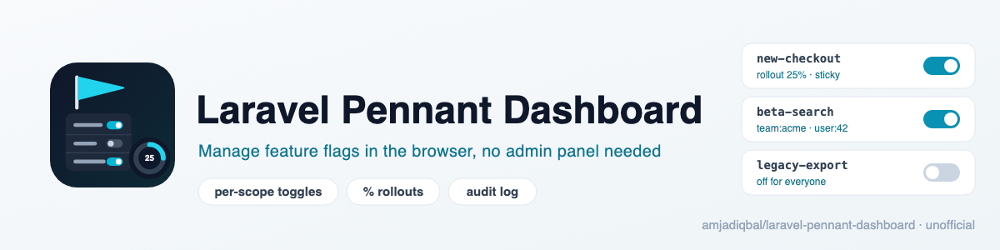
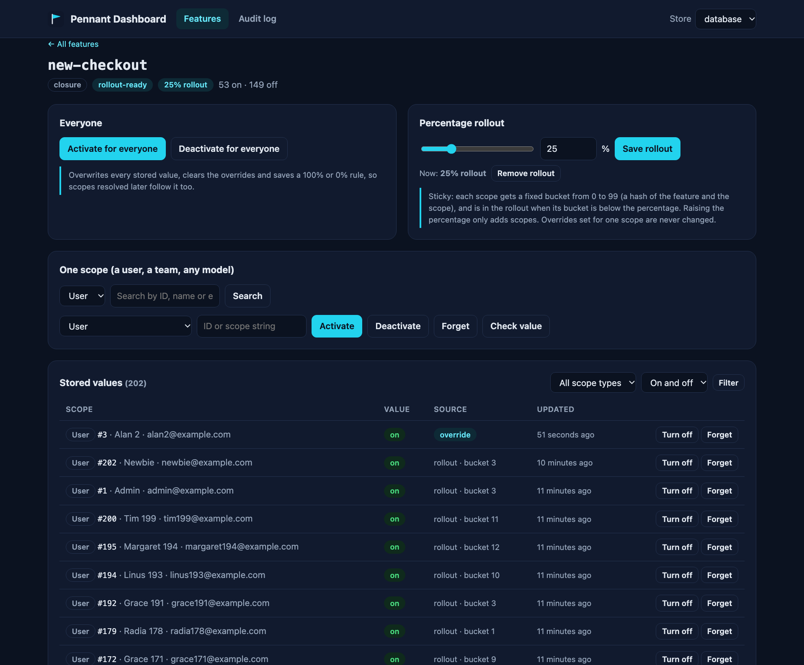

<p align="center">
  <picture>
    <source media="(prefers-color-scheme: dark)" srcset="art/banner-dark.png">
    
  </picture>
</p>

# Laravel Pennant Dashboard: a feature flag UI for Laravel Pennant

A standalone dashboard for [Laravel Pennant](https://laravel.com/docs/pennant) feature flags. See every
feature and what each user, team or other model gets, turn a feature on or off for one scope or for
everyone, roll it out to a sticky percentage of users, purge stored values, and read an audit log of
who changed what. It is plain Blade, so it works in any Laravel 12 or 13 app: **no Filament, Nova or
Livewire needed**.

> Unofficial community package. It is not made, endorsed or supported by Laravel. "Pennant" is the name
> of Laravel's feature flag package, which this dashboard sits on top of.

Docs and demo: https://amjad.com.pk/laravel/packages/laravel-pennant-dashboard

[](https://packagist.org/packages/amjadiqbal/laravel-pennant-dashboard)
[](https://packagist.org/packages/amjadiqbal/laravel-pennant-dashboard)
[](LICENSE.md)

<p align="center">
  
</p>

## What it does

- **Lists every feature** in a Pennant store: closures, class-based features in `app/Features`
  (discovered for you), static values and lotteries, plus features that are stored but no longer defined.
- **Shows each feature's state per scope.** On the database driver you get every stored value with a
  readable label ("User #42 · ada@example.com"), filters by scope type and on/off, and counts per feature.
- **Turns a feature on or off for one scope**: a user, a team, any Eloquent model, `Feature::globally()`,
  or any scope string exactly as Pennant stores it. Search by ID or by the configured `search_columns`
  (name and email by default).
- **Turns a feature on or off for everyone** with Pennant's own `activateForEveryone()`.
- **Percentage rollouts with sticky assignment.** Each scope gets a fixed bucket from 0 to 99, so the
  same users stay in the rollout on every request and every server, and raising 25% to 50% only adds users.
  Lowering it removes the users above the new percentage, except those with an override.
- **Purges** one feature, or every stale feature, through `Feature::purge()`.
- **Audit log**: who changed what and when. Dashboard changes record the signed-in user, the IP and the
  old and new value. Changes made by your own code (`Feature::activate()`) or artisan (`pennant:purge`)
  are logged too, marked as such, with what Pennant's events carry: the feature, the scope and the new
  value (no old value, and no IP).
- **"What does this user see?"**: every feature's value for one scope, on one screen. It is a read-only
  preview: it never stores a value, so it is safe in read-only mode and for view-only users.
- **Reports what your driver supports.** Database and array drivers are fully handled; for a custom
  driver the dashboard says which Pennant contracts it implements and what that means.

## Why this package

Pennant has no UI. The two that exist are a Filament plugin and Laravel's own Nova tool, so an app on
neither has nothing but tinker. This dashboard needs neither: install it, define a gate, open `/pennant`.

It also stays honest about Pennant's semantics. Pennant stores a value the first time a scope is
checked, and `activateForEveryone()` only rewrites values that are already stored. The dashboard says
so where it matters and gives you a one-line way to make "everyone" and rollouts cover users who have
not been checked yet (see [Rollouts](#rollouts-and-everyone)).

## Requirements

- PHP 8.3, 8.4 or 8.5
- Laravel 12 or 13
- `laravel/pennant` 1.18 or newer (installed with this package)

## Installation

```bash
composer require amjadiqbal/laravel-pennant-dashboard
php artisan migrate
```

The migration adds three small tables: `pennant_dashboard_rules` (rollout percentages),
`pennant_dashboard_overrides` (values set for one scope from the dashboard) and
`pennant_dashboard_audit`. If you have not set Pennant up yet, publish and run its migration as the
[Pennant docs](https://laravel.com/docs/pennant#installation) describe.

Open `/pennant` in your browser. Outside `local` it returns 403 until you define who may see it.

## Upgrading

Run the migrations and clear compiled views after every upgrade:

```bash
composer update amjadiqbal/laravel-pennant-dashboard
php artisan migrate
php artisan view:clear
```

`view:clear` matters because Composer's download keeps the package files' original dates. They can be
older than the views your app compiled from the previous version, so Laravel would keep serving the old
compiled dashboard (for example, without the extra tabs added in 1.1.0).

1.0.1 added a `store` column to the rollout and override tables. If you set `run_migrations` to
`false` and published the migrations, publish again first (only the new file is copied):

```bash
php artisan vendor:publish --tag=pennant-dashboard-migrations
php artisan migrate
```

Until the tables are migrated, the dashboard shows a banner and refuses changes, `php artisan about`
says the migration is pending, and the log gets one warning per process. `Rollout::decide()` keeps
working the way 1.0.0 did in the meantime (rules apply to the feature in every store).

## Who can open it

Two gates, defined in a service provider (for example `AppServiceProvider::boot()`):

```php
use Illuminate\Support\Facades\Gate;

Gate::define('viewPennantDashboard', fn (User $user) => $user->is_admin);

// Optional: who may change things. Defaults to whoever may view.
Gate::define('managePennantDashboard', fn (User $user) => $user->email === 'ops@example.com');
```

Without your own `viewPennantDashboard` gate the dashboard is open in the `local` environment only.
Set `PENNANT_DASHBOARD_READ_ONLY=true` to block every change whatever the gates say (previews and
"Check value" never write, so they stay available), and
`PENNANT_DASHBOARD_ENABLED=false` to remove the routes.

## Rollouts and "everyone"

Pennant resolves a feature for a scope the first time it is checked, then stores the result. So a
dashboard can only change what is already stored, unless the resolver asks it. One call does that:

```php
use AmjadIqbal\PennantDashboard\Rollout;
use Laravel\Pennant\Feature;

Feature::define('new-checkout', fn (User $user) => Rollout::decide('new-checkout', $user, default: false));
```

For a class-based feature, use the trait:

```php
use AmjadIqbal\PennantDashboard\Concerns\HasRollout;

class NewCheckout
{
    use HasRollout;

    public function resolve(User $user): bool
    {
        return $this->rollout($user, default: false);
    }
}
```

`Rollout::decide()` returns, in this order:

1. the value set for this scope from the dashboard (an override), if any;
2. the rollout result, if a percentage is set: on when the scope's bucket is below the percentage;
3. your default (a value, or a closure that receives the scope).

The dashboard marks these features **rollout-ready**. For them:

| Action | Stored values | Scopes checked later |
|---|---|---|
| Activate / deactivate for one scope | that scope is set, and remembered as an override | n/a |
| Activate / deactivate for everyone | all overwritten, overrides cleared | follow it (saved as a 100% / 0% rule) |
| Rollout N% | re-bucketed (lowering it turns scopes above N off), overrides kept | follow it |
| Remove rollout | forgotten (overrides kept), resolve from your code again | your default |
| Purge | deleted, overrides cleared | your default (or the rollout, if you keep it) |

For features that do not call `Rollout::decide()`, every action still works the Pennant way, on the
values that are stored; the dashboard tells you when new scopes will not follow.

**Sticky buckets.** A scope's bucket is `crc32(feature|scope) % 100`, where `scope` is Pennant's own
serialized form (`App\Models\User|42`). It does not depend on storage, the server or the order of
requests, so a user never flips in and out of a rollout, and buckets differ per feature so the same
users are not always first.

## Drivers

| | database | array | custom driver |
|---|---|---|---|
| List defined features | yes | yes | yes |
| List every stored scope and value | yes | no | no |
| Set for one scope / everyone, purge | yes | yes, for one request | yes, through the Driver contract |
| Overrides and rollouts with `Rollout::decide()` | yes | yes (read from the package tables) | yes |

The dashboard shows this table for the store you are looking at, read from the contracts the driver
really implements (`CanListStoredFeatures`, `CanSetManyFeaturesForScopes`, `DefinesFeaturesExternally`).
With several stores in `config/pennant.php`, a store picker appears in the header.

Rollouts and overrides belong to the store they were set in. `Rollout::decide()` reads Pennant's
default store; for a feature you resolve through another store, pass it:

```php
Feature::store('redis')->define('new-checkout', fn (User $user) =>
    Rollout::decide('new-checkout', $user, default: false, store: 'redis'));

// or in a class feature: $this->rollout($user, default: false, store: 'redis')
```

## Configuration

```bash
php artisan vendor:publish --tag=pennant-dashboard-config
```

| Key | Default | What it does |
|---|---|---|
| `path` | `pennant` | URL path (`PENNANT_DASHBOARD_PATH`) |
| `domain` | `null` | Serve it on its own domain |
| `middleware` | `['web']` | Route middleware; the gates are checked after it |
| `read_only` | `false` | Block every change (`PENNANT_DASHBOARD_READ_ONLY`) |
| `discover` | `App\Features` in `app/Features` | Discover class-based features while showing the dashboard |
| `scopes` | `App\Models\User` | Model types offered in the scope picker, and the attributes used as labels |
| `search_columns` | `name`, `email` | Columns searched in the scope picker |
| `audit.code_changes` | `true` | Also log changes made by your code and artisan |
| `audit.retention_days` | `180` | Older entries are removed by `php artisan model:prune` |
| `connection`, `tables` | default connection | Where the package's three tables live |
| `run_migrations` | `true` | Set `false` after publishing the migration (`--tag=pennant-dashboard-migrations`) |
| `tabs` | `[]` | Extra nav tabs from your app or other packages: `['label' => 'Experiments', 'route' => 'pennant-experiments.index', 'active' => 'pennant-experiments.*']`. Entries whose route doesn't exist (or needs parameters) are skipped |

To prune the audit log, schedule Laravel's prune command for the model:

```php
Schedule::command('model:prune', ['--model' => [\AmjadIqbal\PennantDashboard\Models\AuditEntry::class]])->daily();
```

The views can be published with `--tag=pennant-dashboard-views`. They are self-contained: inline CSS,
light and dark mode, a few lines of vanilla JavaScript, no build step and no CDN.

## Good to know

- **Checking a value stores nothing.** "Check value" and "What does one scope see?" show the stored
  value where there is one (after a class feature's `before()` hook, as Pennant does), otherwise what
  your resolver returns now, without storing it, caching it or firing Pennant events. Lotteries are not
  drawn. Your resolver does run, so keep resolvers free of side effects.
- **Rollouts are for on/off features.** Features with rich values (strings, arrays) can be viewed,
  forgotten and purged; the rollout writes `true` or `false`.
- **Class features are discovered only on dashboard pages.** Your app's own requests are not touched.
- `php artisan about` shows the installed version and the dashboard path.

## Testing

```bash
composer test          # Pest: rollout math, gates, every action on the database and array drivers, pages
scripts/ci-local.sh    # PHP 8.3-8.5 x Laravel 12-13, Pint, PHPStan, then a lowest-dependencies run
```

## Need this built into your app, or something custom?

I build Laravel features end to end, from feature-flagged releases and admin tools to the packages
behind them. If you want help rolling something out safely, or you need something this package does not
do, [get in touch](https://amjad.com.pk/contact?utm_source=github&utm_medium=readme&utm_campaign=laravel-pennant-dashboard).

## Support

- 🐛 **Bug or feature request**: [open an issue](https://github.com/amjadiqbal/laravel-pennant-dashboard/issues)
- 🔒 **Security issue**: please report privately via GitHub's security tab

## Need this customised, or something built?

I'm available for custom development, package integration, and technical consulting.

[](https://www.upwork.com/freelancers/amjadkhatri)

## More packages

Part of a family of open-source packages. See [all of them](https://github.com/amjadiqbal?tab=repositories).

| | |
|---|---|
| [laravel-driver-js](https://github.com/amjadiqbal/laravel-driver-js) | Product tours and onboarding for Laravel |
| [kiln](https://github.com/amjadiqbal/kiln) | Deploy-time OPcache control for Laravel |
| [laravel-mysql-advisor](https://github.com/amjadiqbal/laravel-mysql-advisor) | MySQL and MariaDB health checks with the SQL to fix each one |
| [laravel-logpulse](https://github.com/amjadiqbal/laravel-logpulse) | Log health monitoring and alerting |

## Changelog

See [CHANGELOG.md](CHANGELOG.md).

## License

MIT. See [LICENSE.md](LICENSE.md). This package is independent and not affiliated with Laravel.
